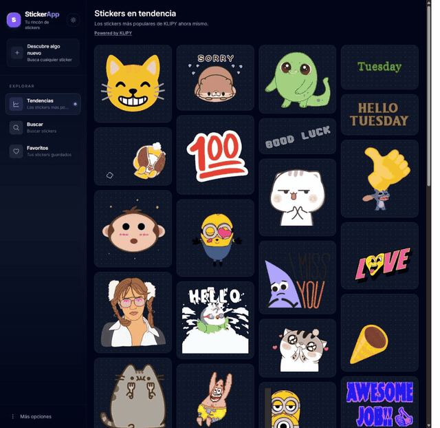
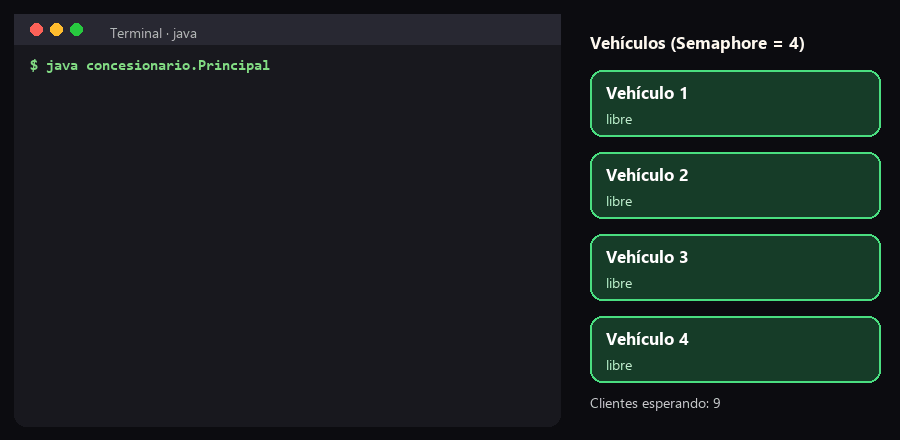

  

  
  

Hago aplicaciones de principio a fin: el back-end con C# y .NET o con Python y FastAPI, el front-end con Angular y apps móviles con Flutter. Me gusta que lo que construyo se use de verdad y tenga pruebas detrás.

## 🚀 Proyectos destacados

<table>
  <tr>
    <td width="50%" valign="top">
      
      <h3><a href="https://github.com/eduardolar/SiestaDescanso">Siesta y Descanso</a></h3>
      Gestor de stock y pedidos para una tienda de muebles: sigue cada venta desde que se encarga hasta que se entrega.  
      <code>C#</code> <code>.NET 10</code> <code>WPF</code> <code>EF Core</code> <code>SQLite</code> · ~300 pruebas
    </td>
    <td width="50%" valign="top">
      
      <h3><a href="https://github.com/eduardolar/StickerApp">StickerApp</a></h3>
      App para buscar, guardar y compartir stickers animados, con modo oscuro y funciones nativas de Android.  
      <code>Angular 22</code> <code>signals</code> <code>Capacitor 8</code> <code>Vitest</code> · 68 pruebas
    </td>
  </tr>
  <tr>
    <td width="50%" valign="top">
      
      <h3><a href="https://github.com/eduardolar/ConcesionarioSemaforos">ConcesionarioSemaforos</a></h3>
      Concurrencia en Java: varios clientes, cada uno en su hilo, se reparten unos pocos vehículos con un semáforo.  
      <code>Java</code> <code>Semaphore</code> <code>synchronized</code>
    </td>
    <td width="50%" valign="top">
      <h3>💼 Dónde he trabajado</h3>
      <b>Zaitec</b> (2026, remoto): SaaS multi-tenant con FastAPI y MongoDB, app en Flutter, Stripe y Docker en Render.  
      <b>Copermática</b> (2023): Angular y TypeScript, C# con ASP.NET Web API y Entity Framework sobre SQL Server, Scrum y pull requests con revisión de código.  
      <b>Freelance</b> (2026): app de reservas para un gimnasio, en producción. Flutter y Supabase con RLS, más de 350 pruebas (código del cliente).
    </td>
  </tr>
</table>

## 🔒 Proyectos con código privado

El código no es público. Las demos usan datos de ejemplo.

<table>
  <tr>
    <td width="50%" valign="top">
      
      <h3>AgendaFit</h3>
      App para que un gimnasio vea qué instructores están libres, reparta turnos y ocupe huecos con clientes. En producción en un gimnasio.  
      <code>Flutter</code> <code>Supabase</code> <code>PostgreSQL</code> <code>RLS</code> · más de 350 pruebas
    </td>
    <td width="50%" valign="top">
      
      <h3>Tempo Gym</h3>
      App de clases y reservas para gimnasios: calendario semanal, reserva de plaza, lista de espera y gestión de aulas, aforos y caja. Un mismo código para varios gimnasios.  
      <code>Flutter</code> <code>Supabase</code> <code>Docker</code> · Android, web y Windows
    </td>
  </tr>
</table>

## 🛠️ Tecnologías

  

## 🐍 Mi actividad

<picture>
  <source media="(prefers-color-scheme: dark)" srcset="https://raw.githubusercontent.com/eduardolar/eduardolar/output/serpiente-oscura.svg">
  
</picture>

🎓 Técnico Superior en DAM (MEDAC) · Máster en Big Data Engineering (Davante) · Grado en Psicología · 📍 Ciudad Real, España
